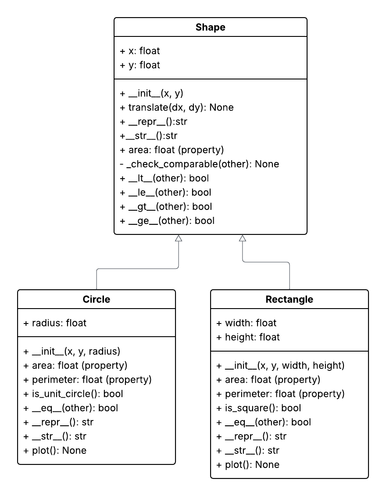

# Geometry OOP

Object-oriented Python classes for 2D geometric shapes, built as part of the Python programming course in the Data Engineering program at STI.

The goal was to plan a class structure with UML first and then implement it in Python using inheritance, properties, operator overloading and error handling.

## Class structure



`Shape` is the base class and holds the center position (`x`, `y`), movement and comparisons. `Circle` and `Rectangle` inherit from it and add their own size, area and perimeter.

## Features

- Read-only `area` and `perimeter` properties
- `translate(dx, dy)` to move a shape
- Comparison of shapes by area with `<`, `<=`, `>`, `>=`, including between different shape types
- Equality with `==` based on each shape's own dimensions
- `is_unit_circle()` and `is_square()` checks
- Input validation with clear `TypeError` and `ValueError` messages
- `plot()` to draw a shape at its actual position and size with matplotlib

## Example

```python
from circle import Circle
from rectangle import Rectangle

circle = Circle(x=0, y=0, radius=1)
rectangle = Rectangle(x=2, y=1, width=3, height=2)

circle.is_unit_circle()   # True
rectangle > circle        # True, compares areas
circle.translate(5, 3)    # moves the center to (5, 3)
circle.plot()

Rectangle(width=3, height="5")   # raises TypeError
```

## Design decisions

- **Comparisons live in `Shape`.** All shapes are compared by area, so `<`, `<=`, `>`, `>=` are written once in the base class and inherited. This follows the DRY principle and makes comparisons consistent across shape types.
- **Equality lives in each subclass.** "Equal" means the same radius for circles and the same width and height for rectangles, so `__eq__` is defined per class.
- **Rectangles are positioned by their center.** Matplotlib draws rectangles from the bottom-left corner, so `plot()` converts the center to a corner before drawing.

## Files

| File | Description |
|---|---|
| `shape.py` | Base class `Shape` |
| `circle.py` | `Circle` class |
| `rectangle.py` | `Rectangle` class |
| `test.ipynb` | Manual tests and plots |
| `uml_diagram.png` | UML class diagram |

## How to run

Requires Python 3 and matplotlib.

```bash
pip install matplotlib
```

Open `test.ipynb` in VS Code or Jupyter and run all cells.

## Possible improvements

- 3D shapes (`Cube`, `Sphere`)
- Automated unit tests with `pytest`
- A plotter class that draws several shapes in the same figure